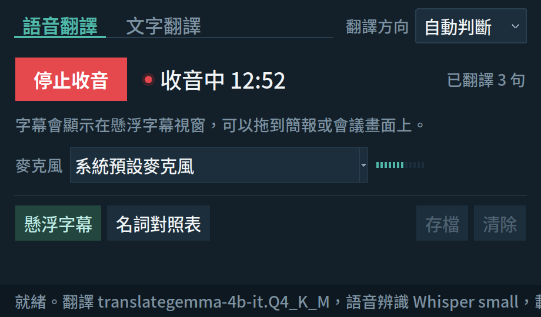
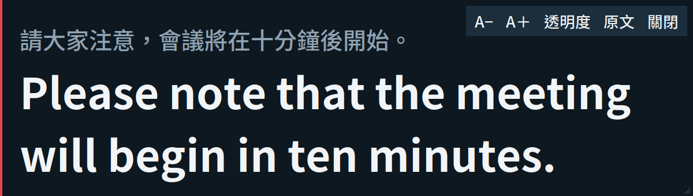

# CPU 中英語音翻譯（離線）

用麥克風說中文就即時翻成英文，說英文就翻成繁體中文（台灣用語）。全部在本機 CPU 執行，不需要 GPU；裝好之後也不需要網路。

- 語音辨識：Whisper small（[faster-whisper](https://github.com/SYSTRAN/faster-whisper)，CPU int8）
- 翻譯：Google TranslateGemma 4B Q4（[llama.cpp](https://github.com/ggml-org/llama.cpp) 官方預編 CPU 版）
- 介面：桌面視窗（tkinter），有「語音翻譯」和「文字翻譯」兩個分頁

## 下載與安裝

到 [Releases](https://github.com/Patric891228/cpu-speech-translation/releases) 下載。

都不用安裝 Python。第一次開啟會自動下載模型（約 3GB，需要網路，狀態列顯示進度），之後離線可用。

**Windows**：下載 `SpeechTranslate-Windows-版本.zip`，解壓縮後雙擊 `SpeechTranslate.exe`。

**Linux**（Ubuntu 22.04 以上）：下載 `SpeechTranslate-Linux-版本.tar.gz`，在終端機執行：

```bash
tar xzf SpeechTranslate-Linux-*.tar.gz
./SpeechTranslate/SpeechTranslate
```

**想用原始碼執行**：下載 Source code (zip)
- Ubuntu 先執行 `sudo apt install python3-tk python3-venv`，再執行 `./啟動翻譯.sh`
- Windows 先從 [python.org](https://www.python.org/downloads/) 安裝 Python 3，再雙擊 `啟動翻譯.bat`

第一次會自動安裝套件、下載 llama.cpp 和模型。下載中斷時重新開啟即可，會接著下載。

需求：記憶體 16GB（程式約佔 4GB）、硬碟約 4GB。

## 使用



語音翻譯：
1. 等狀態列顯示「就緒」
2. 右上角選「翻譯方向」（預設「自動判斷」：在中文、英文之間判斷），需要的話選麥克風
3. 按「開始收音」：懸浮字幕視窗會自動彈出，最新一句的譯文用大字、原文用小字顯示。每句停頓約 0.6 秒後送出辨識
4. 按「停止收音」後，「存檔」可以把這次的原文和譯文存成文字檔，「清除」清掉內容重新開始（收音中不能按）

懸浮字幕：沒有邊框、永遠在最上層、半透明，可以拖到簡報或會議畫面上任何位置，右下角拖曳調整大小。滑鼠移上去會出現工具列（字級、透明度、顯示原文、關閉）。左邊的細色條在收音中是紅色。



主視窗預設釘選在最上層，不會被其他視窗蓋住。

## 名詞對照表

機關名稱、人名、專有名詞的指定譯法放在 `名詞對照表.csv`，可以用 Excel 編輯，也可以按視窗上的「名詞對照表」按鈕開啟。存檔後下一句就會套用，不用重開程式。

| 中文 | 英文 | 辨識常錯成（可空白，多個用 / 隔開） |
|---|---|---|
| 疾管署 | Taiwan CDC | 機關處/機關署 |

- 中翻英：句子裡有「疾管署」就譯成 Taiwan CDC；英翻中：有「Taiwan CDC」就譯成中文欄的詞
- 同一個詞出現在好幾列時，用最上面那一列
- 「辨識常錯成」：語音辨識完馬上改正，例如把「機關處」改成「疾管署」
- 英文縮寫（WHO、MOHW）要大小寫完全相同才算，小寫的 who 不會被當成 WHO

## 檔案

| 檔案 | 說明 |
|---|---|
| `translator.py` | 主程式、翻譯引擎 |
| `ui.py`、`widgets.py`、`overlay.py` | 視窗、自己畫的元件（分頁、下拉選單、按鈕）、懸浮字幕 |
| `speech.py` | 收音、切句、語音辨識、過濾 Whisper 幻覺 |
| `glossary.py`、`名詞對照表.csv` | 名詞對照表 |
| `zhconv.py` | 簡體轉繁體（不誤改本來就對的繁體字） |
| `install.py` | 第一次執行的安裝與下載 |
| `.github/workflows/build.yml` | 推 `v*` 標籤時在 GitHub 的 Windows 主機打包 exe，實際執行 `--selftest` 通過才附到 Release |
| `bin/`、`models/`、`.venv/` | 安裝時產生，不放進 git |

## 授權

- 程式：自用
- TranslateGemma：[Gemma 使用條款](https://ai.google.dev/gemma/terms)
- Whisper：MIT；llama.cpp：MIT
- 分頁、下拉選單、按鈕波紋的動作移植自 [Motion Prompt](https://showheyohtaki.github.io/motion-prompt/)（#057、#053、#085，MIT）
